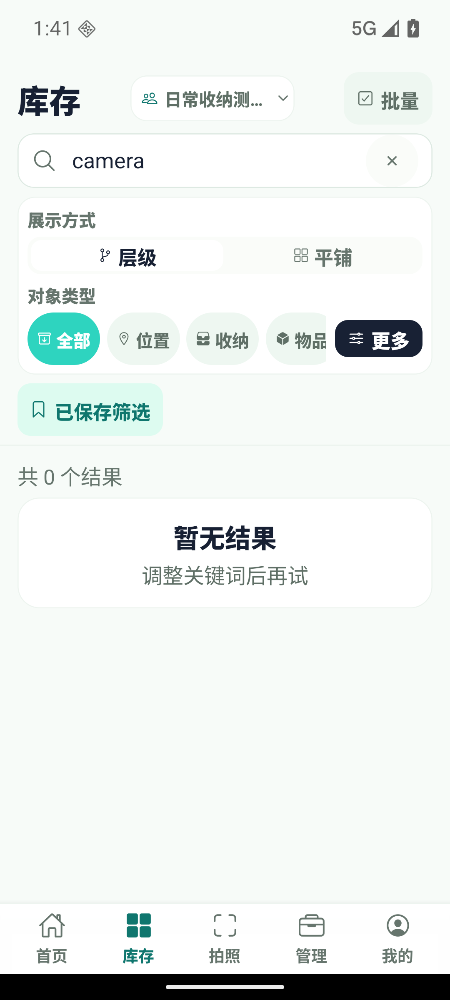
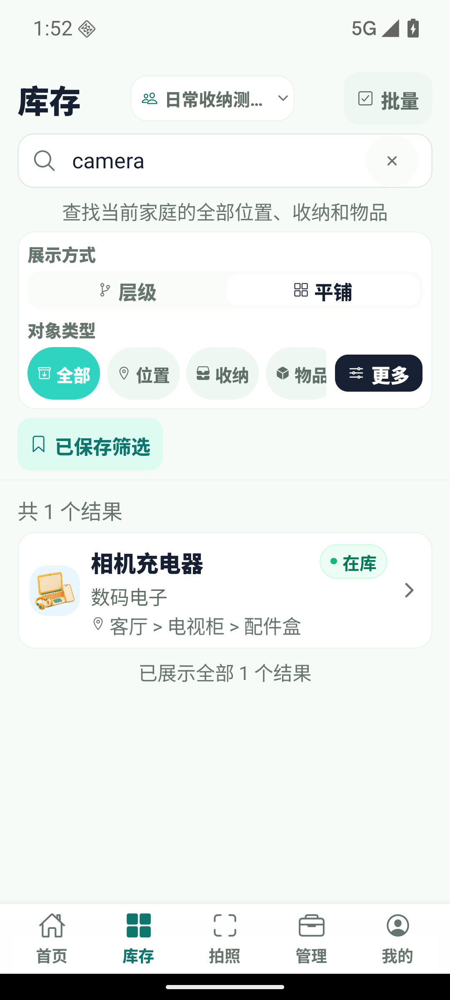
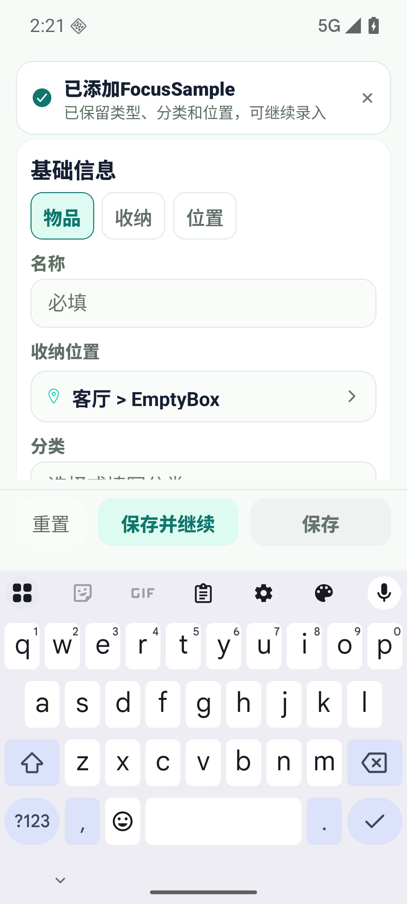
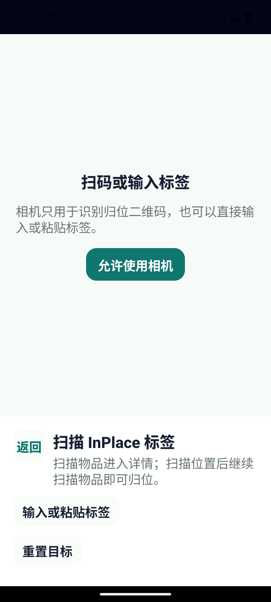
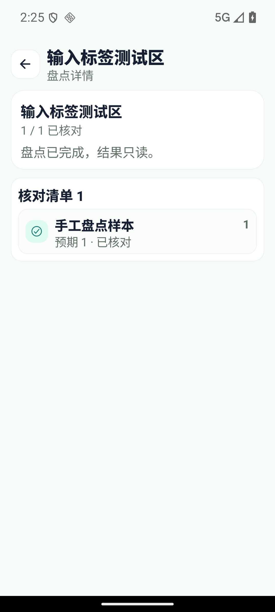

# 日常收纳便捷性优化

目标：减少查找、录入、移动、消耗、借还和家庭协作中的重复操作，让失败后能继续原任务。

## Impact Map

- Goal: 首页直接找物品；跨层查找位置；同一位置连续录入；直接设置库存；日期提交可用；快捷切换家庭；首次连接说明清楚；扫码不可用时仍能输入标签。
- Scope: Web、Mobile 的库存与入口交互，app-core 的位置候选、连续录入上下文和日期转换。保留现有 API 与数据库结构。
- Risk: 共享家庭切换后的数据隔离、只读角色、位置循环、重复提交、保存失败误清空，以及原生键盘与返回行为。
- No-touch: 已有未跟踪目录、本地配置、真实库存、生产服务、发布凭据。
- Validation: 现有测试基线，针对跨层搜索、位置排除、继续录入、日期和失败恢复的回归检查；受影响 workspace lint/typecheck/test/build；隔离 API + 浏览器桌面/移动断点 + Android 模拟器操作验证。
- Knowledge update: 本文记录观察、验收与证据边界；必要时更新双端产品能力说明。

## 能力判断

当前应用已经覆盖手工与拍照录入、层级收纳、组合搜索、标签归位、数量与批次、借还维护、盘点、家庭协作，以及导入导出。日常使用的主要成本在入口深、上下文反复填写和失败后恢复，因此本次优先打通找物、连续录入和库存维护路径。地图、AI 模型效果、打印与备份能力保持现有边界，本次不将它们列为新完成的能力。

## 已观察的问题

2026-10-15 使用独立测试家庭与三级收纳数据，Web 截图、Android 模拟器和真实隔离 API 建立基线。

| 任务 | 当前障碍 | 目标行为 |
| --- | --- | --- |
| 找物品 | 首页没有搜索入口；Android 库存默认层级，搜索仅命中当前层 | 首页直达并聚焦全局搜索；层级模式清楚标出范围 |
| 选位置 | 两端需要逐层进入，深层目标选择成本高 | 搜索名称或完整路径，一次选中；不能移动到自身或后代 |
| 连续录入 | 每次保存关闭表单，重新选位置和分类 | 保存并继续，保留类型/位置/分类，清空新物品字段 |
| 库存消耗/补货 | 只能加减一；Android 请求中仍可重复点击 | 直接设置数量；请求中锁定，失败保留输入 |
| 借还/维护 | Android 发送日期字符串，API 要求 datetime，实际返回 400 | 日历选择并转换为同一本地日期的 ISO 时间；失败可重试 |
| 保存恢复 | Web 生命周期 catch 后仍执行清空回调 | 仅成功写入后清空；区分写入成功和列表刷新失败 |
| 切换家庭 | Android 经管理页切换，再返回原页面 | 原页面弹出选择，选择后恢复使用，管理入口独立 |
| 首次使用 | 默认 localhost 地址容易被误当成可用服务 | 未配置时输入提示清楚，保留已配置地址，维持 HTTPS 要求 |
| 扫码/盘点 | Android 无摄像头权限时缺少标签输入入口 | 可手动输入或粘贴标签/链接，沿用相同解析和权限 |

## 验收清单

- [x] Web/Android：首页一键进入全局搜索，找到三级位置下的物品；返回后保留搜索上下文。
- [x] Web/Android：搜索深层位置并选择；编辑/批量移动时排除自身与全部后代；加载失败可重试。
- [x] Web/Android：同一位置连续保存两件物品，只保留类型、分类、位置；保存失败保留内容；普通保存关闭；取消有未保存内容时确认。
- [x] Web/Android：一次请求将库存调整为指定值，拒绝负数/小数，保存期间不会重复提交。
- [x] Web/Android：借出、归还、维护和批次操作实际成功；无效日期或请求失败保留输入；刷新失败不提示重新提交已成功操作。
- [x] Android：快捷切换共享/个人家庭，原页面更新；只读家庭无写入口且 API 拒绝写入。
- [x] Android：首次连接地址、错误和键盘操作清楚；已保存地址可复用，正式环境仍要求 HTTPS。
- [x] Android：无相机权限时输入已绑定、未绑定、无效标签；盘点支持相同输入路径。
- [x] Web 桌面/移动断点与 Android：空位置可继续新增，筛选/返回/弹窗/键盘无阻塞；无新控制台或原生运行错误。

## 验证结果

2026-10-15，使用独立 PostgreSQL、API、Web 服务、Android 调试包及虚构家庭数据。浏览器验收覆盖 390px 和 1440px，Android 使用独立模拟器。以下区分界面操作、API 回读和自动化回归，不把其中一种当作另一种。

| 验收项 | 当前证据 |
| --- | --- |
| 全局查找 | Android 同一家庭、同一三级位置和 `camera` 查询：默认层级模式为 0 条，首页搜索进入平铺后为 1 条；Web 两种宽度均找到相机充电器，打开详情再返回保留查询。导航回归检查首页入口会清除旧位置、类型、状态和标签限制。 |
| 位置选择 | 两端实际按路径选中三级配件盒；Web 单项移动排除客厅及下级，批量移动同时排除客厅、卧室及下级。Web 注入 503 后点击重试恢复；原生组件回归覆盖加载失败、重试、完整路径搜索和后代排除。 |
| 连续录入 | Web 两种宽度和 Android 分别连续创建两件物品，API 回读确认位置、分类一致，第二件无第一件备注。Web 503 后名称保留，普通保存关闭；Android 保存后键盘出现，直接输入进入已清空的名称栏。两端取消未保存内容需确认。 |
| 数量 | Web/Android 实际直接设为 120；回归验证一次写请求和重复点击锁定，数量解析拒绝负数、小数、空值和超出安全整数范围。设置库存后新增批次仍从 1 开始。 |
| 借还维护 | 两端实际完成借出、归还、维护和批次入库。Android 无效日期保留输入；应还日期 `2027-01-15` 回读为 `2027-01-15T04:00:00.000Z`（测试设备 UTC+8），批次日期保持 `2027-03-01`。原生日期控件可打开和取消。Web 注入借出 503 后重试成功；组件回归覆盖写入成功但刷新失败时不重复提交。 |
| 家庭和权限 | Android 两次点击完成共享/个人家庭切换，原页面数据随之更新；只读成员能输入已绑定标签查看详情，无新增、盘点和数量写入口。Web 实测只读 UI，API 更新物品和借出均返回 403。 |
| 首次连接 | 清空独立调试包后，服务器字段为空；空提交提示补齐字段。错误端口显示连接诊断，修正地址后登录成功；退出后地址保留。URL 回归覆盖域名补全、`/api` 路径、非法地址与正式环境 HTTPS 限制。 |
| 标签与盘点 | 相机权限未授予时，实际输入无效、已绑定、未绑定标签；无效内容保留，未绑定标签成功绑定 NativeFirst。手工输入盘点标签后 API 回读 `completed`、核对数 1、状态 `found`，界面进入只读并显示“已核对”。 |
| 空位置与返回 | Android 空收纳显示添加指引，新增自动带入 EmptyBox；Web 两种宽度同样带入当前位置。原生连续录入键盘、返回确认、日期弹窗均实测；浏览器流程没有 pageerror，Metro 未记录运行 ERROR。 |

## 检查记录

| 命令 / 检查 | 结果 |
| --- | --- |
| `npm test --workspace @inplace/web -- --run` | 33 个测试文件、109 项通过 |
| `npm test --workspace @inplace/mobile` | 19 个测试套件、67 项通过 |
| Web / Mobile `lint` | 通过 |
| Web / Mobile / App Core / Server `typecheck` | 通过 |
| `npm run build:web` | 通过 |
| Android `expo export --platform android` | 通过；生成 4.61 MB Hermes bundle 与 metadata |
| `git diff --check` | 通过 |

自动化覆盖点包括：连续录入上下文、失败保留、重复提交、刷新失败、位置后代排除、日期和数量输入、只读入口。Web 用例由原有 105 项增至 109 项；Mobile 由原有 53 项增至 67 项。

## 脱敏截图

所有截图仅使用独立测试家庭与虚构物品。

| Android 原搜索 | Android 全局搜索 |
| --- | --- |
|  |  |

| 连续录入 | 无相机标签输入 | 完成盘点 |
| --- | --- | --- |
|  |  |  |

Web 手机布局：[新增表单](../assets/convenience/web-after-390-form.png)。

## 交付边界与恢复

本次为 Web、Mobile 和 App Core 的客户端改动，没有修改 API 契约或数据库 schema，现有数据无需迁移。以上记录为发布前验证；测试使用本地隔离服务，不代表生产部署、实体设备相机或 iOS 验收。Android 导出验证 JavaScript 生产打包，不等于重新生成并发布签名 APK。

回退时恢复本分支涉及的客户端文件并重新构建即可，新增库存仍使用原有接口和字段。已有未跟踪目录、真实库存、本地配置与生产服务均未改动。
